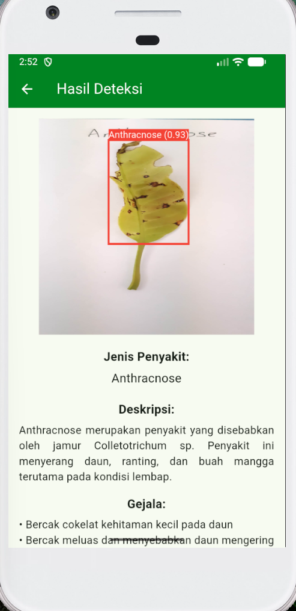

# Detection-of-Mango-Plant-Diseases
This project aims to assist farmers in detecting early-stage mango leaf diseases through a mobile Android application powered by YOLO11n.

## Insight:
- Preprocessed 1,405 Harum Manis mango leaf images using Roboflow for manual bounding box annotation and resizing (640x640) across three classes: Anthracnose (525), Sooty Mould (656), and Healthy (224).
- Split the dataset into 70% training, 15% validation, and 15% testing sets to train and evaluate the YOLO11n model across 4 distinct hyperparameter scenarios (varying batch sizes 16/24, SGD/Adam optimizers, 50 epochs, learning rate 0.01, and patience 10).

## Outcome:
Scenario 3 emerged as the optimal configuration on the validation dataset and achievied a precision 0.993, recall 0.983, accuracy 0.990, F1-score 0.988, mAP50 0.995, and mAP50-95 0.917 on testing dataset.

## Application:
This application features an intelligent diagnostic tool that enables users to easily capture or upload mango leaf images directly via their device's camera or photo gallery. Built for high performance and efficiency, testing results demonstrate that the system processes each image and delivers complete detection results within just 5 seconds. The comprehensive output not only highlights affected areas using precise bounding boxes paired with disease labels and confidence scores, but also provides valuable insights into disease characteristics, observed symptoms, and actionable preventive measures.

